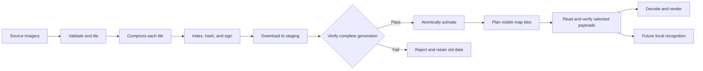

# Crystal Geo Mobile App: Detailed Build Instructions

## 1. What this app is

Crystal Geo is a mobile app for viewing geographic imagery when the phone or
tablet has little or no network access. Before going offline, the app downloads
a signed imagery package for a selected area. While offline, a user can pan and
zoom the map, inspect imagery details, and eventually run an on-device
recognition model against selected locations.

The app is meant for field work where connectivity is unreliable and where it
is important to know exactly which imagery and software produced a result. A
typical user might be inspecting infrastructure, documenting disaster damage,
surveying land, or reviewing environmental changes. Crystal Geo does not claim
that an image is correct or current. It proves that the downloaded files came
from an approved publisher and that they have not changed since publication.

The first release should focus on secure offline storage and map viewing.
On-device recognition should be added only after storage, retrieval, update,
and verification behavior has been measured and validated.

## 2. General data flow

1. A trusted publisher obtains source imagery and metadata.
2. A packaging tool validates the imagery, divides it into map tiles, creates
   multiple resolution levels, and compresses each tile independently.
3. The tool creates a geographic index, hashes the index and stored tile
   payloads, builds a manifest, and signs the manifest with the publisher's
   private key.
4. The mobile app downloads the generation into a staging directory. It never
   writes a partial update over the active generation.
5. The app verifies the manifest signature, version policy, index hash, tile
   hashes, and required files.
6. If every required check passes, the app atomically makes the staged
   generation active. Otherwise, it rejects the update and keeps using the
   previous generation.
7. When the user moves the map, the UI asks the map planner for visible tiles.
   The storage service locates and reads only those payloads, verifies them,
   decompresses them, and supplies pixels to the map renderer.
8. A future recognition planner can request higher-resolution and neighboring
   tiles through the same verified retrieval path. Findings retain the imagery
   generation, capture time, model version, and processing settings.



## 3. Reference implementation choices

These instructions use a concrete stack so the implementation is reproducible:

- **Mobile UI:** Flutter and Dart for one Android/iOS codebase.
- **Map rendering:** Flutter `CustomPainter` for the first prototype, followed
  by a texture-backed renderer if profiling shows that it is required.
- **Trusted core:** Rust for package parsing, hashing, signature verification,
  tile reads, decryption, and decompression. Expose a narrow API to Flutter with
  `flutter_rust_bridge`.
- **Index:** SQLite in read-only mode on the device, with R-tree spatial indexes.
- **Package metadata:** canonical CBOR for the signed manifest. JSON may be
  emitted beside it for debugging, but must not be trusted or signed.
- **Payload containers:** immutable binary container files capped at a
  configurable size, initially 512 MiB.
- **Compression:** lossless WebP for imagery where exact pixels matter and
  lossy WebP for visual basemaps. Keep the codec field extensible. Benchmark
  against MBTiles using identical source pixels.
- **Integrity and signatures:** SHA-256 payload and file hashes, with Ed25519
  signatures over the canonical manifest bytes.
- **Optional confidentiality:** AES-256-GCM per payload, using a unique 96-bit
  nonce for every encrypted payload and keys held in Android Keystore or Apple
  Keychain. Do not invent a custom cipher or key-storage mechanism.

Pin exact dependency versions in lockfiles. Generate a software bill of
materials in CI and review security advisories before each release.

## 4. Repository layout

Create the following structure:

```text
DellGBHackathon/
  app/                         Flutter application
    lib/
      app/
      core/
      features/map/
      features/datasets/
      features/recognition/
      features/settings/
    test/
    integration_test/
    android/
    ios/
  crates/
    crystal_core/              Trusted Rust library
    crystal_format/            Manifest, index, and container definitions
    crystal_pack/              Publisher-side packaging CLI
    crystal_bench/             Format and performance benchmarks
  schemas/
    manifest.cddl              Canonical CBOR schema
    index.sql                  SQLite schema
    findings.schema.json
  testdata/
    tiny_valid_generation/
    corrupted_generations/
  docs/
    threat-model.md
    format-specification.md
    key-management.md
    recovery-policy.md
  .github/workflows/
  Cargo.toml
  pubspec.yaml                 Or keep this under app/ if Flutter requires it
```

Keep package-format code independent of Flutter. The packaging CLI and mobile
app must use the same Rust parsing and verification library so that format
rules are not duplicated.

## 5. Mobile user interface

### 5.1 Navigation model

Use four primary destinations:

1. **Map** — the default screen for offline imagery.
2. **Datasets** — download, update, activate, inspect, and remove generations.
3. **Findings** — recognition requests and results; disabled or labeled
   experimental until the model pipeline is validated.
4. **Settings** — storage limits, network policy, diagnostics, licenses, and
   trusted publisher information.

On phones, use a bottom navigation bar. On tablets, use a navigation rail and
allow the dataset or finding detail panel to remain visible next to the map.
Preserve the current map camera and selected item when moving between screens.

### 5.2 First-run experience

Build a three-step first-run flow:

1. Explain that map packages must be downloaded before offline use.
2. Explain that verification proves origin and integrity, not real-world
   accuracy or freshness.
3. Ask the user to choose a dataset or import a package. Do not request location
   permission until the user taps "Show my location."

If no dataset is installed, the Map screen should show an empty-state card with
buttons for **Download dataset** and **Import package**.

### 5.3 Map screen

The Map screen must contain:

- A full-screen map canvas supporting pan, pinch zoom, double-tap zoom, and
  rotation only if the renderer can preserve correct coordinate transforms.
- A compact dataset badge showing dataset name, capture date or date range,
  active generation, and offline status.
- A scale bar and current zoom/resolution indicator.
- A location button, gated by runtime permission.
- An imagery information button that opens source, license, acquisition time,
  resolution, and freshness warnings for the tile under the crosshair.
- A layer control for imagery, findings, and optional vector overlays.
- A recognition action that lets the user select a point or rectangular area.
- A persistent banner for serious conditions such as failed verification,
  unsupported generation, missing tiles, or a generation older than policy.

Never display an unverified tile as if it were trusted. Use a neutral
checkerboard for missing tiles and a distinct warning tile for failed
verification. Do not silently substitute network imagery while the user is in
offline mode, because that would obscure the source and capture time.

### 5.4 Map rendering state and events

Represent map state with an immutable model:

```text
MapViewState
  generation_id
  center_latitude
  center_longitude
  zoom
  viewport_width_px
  viewport_height_px
  device_pixel_ratio
  visible_tile_keys[]
  selected_feature
  loading_tile_count
  warning
```

For every camera change:

1. Debounce requests for 16–32 ms so a gesture does not flood the queue.
2. Compute the required zoom level and visible tile coordinates.
3. Request a one-tile margin around the viewport to reduce visible loading.
4. Prioritize tiles nearest the viewport center.
5. Cancel queued work for tiles that are no longer relevant.
6. Keep already decoded tiles in a bounded memory cache.
7. Repaint as each verified tile becomes available.

Do not cancel an in-progress integrity check halfway through a file read. Allow
it to finish, then discard the decoded result if the request is stale.

### 5.5 Dataset screen

Show installed and available datasets separately. Each installed dataset row
must show:

- Coverage name and a small geographic preview.
- Publisher and signature status.
- Capture date range and download date.
- Active generation and available update.
- Installed size and estimated update size.
- State: ready, downloading, verifying, activating, failed, or unsupported.

The dataset detail screen should provide **Update**, **Pause**, **Resume**,
**Verify again**, **Make active**, **Delete**, and **View technical details**.
Deletion must require confirmation and must not remove the active generation
until another usable generation is selected or the user explicitly accepts
that the map will become unavailable.

Display download and verification as separate progress phases. A download at
100% is not ready until verification and atomic activation succeed.

### 5.6 Recognition UI

Treat recognition as an asynchronous job:

```text
RecognitionRequest
  request_id
  generation_id
  geographic_region
  requested_resolution
  context_margin_meters
  model_id
  model_version
  created_at
  status
```

After the user selects a region, show the imagery date, requested resolution,
estimated processing time, and a clear **Run on device** action. Results should
appear as map overlays and in a list. Every finding must show confidence or
uncertainty, source imagery time, model version, and whether a person reviewed
it. Avoid language that presents probabilistic output as confirmed fact.

### 5.7 Accessibility and failure handling

- Support dynamic text, screen readers, high contrast, and a minimum 44-point
  iOS/48-dp Android touch target.
- Never communicate verification state by color alone; pair it with an icon and
  text.
- Keep critical controls usable in portrait and landscape orientations.
- Provide actionable errors: what failed, whether existing offline data is
  still usable, and what the user can do next.
- Save download state and map camera state across process termination.
- Test with airplane mode, low storage, interrupted writes, and device restarts.

### 5.8 Flutter implementation sequence

1. Create the Flutter app and define feature folders.
2. Add a dependency-injection boundary for `DatasetRepository`, `TileRepository`,
   `RecognitionRepository`, and `TrustRepository`.
3. Implement fake repositories and finish the UI against deterministic fixtures.
4. Build the map camera, tile planner, loading states, and error tiles.
5. Bind the repositories to the Rust core through generated bridge types.
6. Add background download integration using Android WorkManager and iOS
   background URL sessions. Respect each platform's execution limits.
7. Add integration tests for first run, dataset activation, offline map use,
   corrupt tile handling, and interrupted updates.
8. Profile on the oldest supported device before adding recognition.

## 6. Data layer

### 6.1 Generation directory contract

Store immutable generations under an application-private directory:

```text
datasets/<dataset_id>/
  active                     Small pointer file or symlink-like logical record
  generations/
    <generation_id>/
      manifest.cbor
      manifest.sig
      index.sqlite
      containers/
        container-000001.bin
        container-000002.bin
      READY                  Written only after full verification
  staging/
    <generation_id>.partial/
  quarantine/
```

The `active` record contains a generation identifier and checksum. Update it
with write-to-temp, file sync, atomic rename, and parent-directory sync. On
platforms where a rename guarantee differs, put the pointer in SQLite and use a
single committed transaction. Never mutate files inside a ready generation.

### 6.2 Required identifiers

- `dataset_id`: stable UUID for the logical dataset.
- `generation_id`: sortable, publisher-assigned identifier that is never reused.
- `tile_key`: `(crs, zoom, x, y, variant)`.
- `container_id`: immutable identifier for one payload container.
- `publisher_key_id`: SHA-256 fingerprint of the trusted public key.

Do not use display names as identifiers. Normalize identifiers at package build
time and reject path separators, control characters, and unsafe lengths.

### 6.3 SQLite index schema

Start with the following conceptual tables and add strict constraints in
`schemas/index.sql`:

```sql
CREATE TABLE generation_metadata (
  generation_id TEXT PRIMARY KEY,
  dataset_id TEXT NOT NULL,
  format_version INTEGER NOT NULL,
  created_at TEXT NOT NULL,
  min_zoom INTEGER NOT NULL,
  max_zoom INTEGER NOT NULL,
  crs TEXT NOT NULL
) STRICT;

CREATE TABLE tiles (
  tile_id INTEGER PRIMARY KEY,
  zoom INTEGER NOT NULL,
  tile_x INTEGER NOT NULL,
  tile_y INTEGER NOT NULL,
  variant TEXT NOT NULL,
  min_x REAL NOT NULL,
  min_y REAL NOT NULL,
  max_x REAL NOT NULL,
  max_y REAL NOT NULL,
  width_px INTEGER NOT NULL,
  height_px INTEGER NOT NULL,
  padding_px INTEGER NOT NULL DEFAULT 0,
  capture_time TEXT,
  source_id TEXT NOT NULL,
  container_id TEXT NOT NULL,
  payload_offset INTEGER NOT NULL CHECK (payload_offset >= 0),
  payload_length INTEGER NOT NULL CHECK (payload_length > 0),
  codec TEXT NOT NULL,
  codec_parameters BLOB NOT NULL,
  stored_sha256 BLOB NOT NULL CHECK (length(stored_sha256) = 32),
  nonce BLOB,
  UNIQUE (zoom, tile_x, tile_y, variant)
) STRICT;

CREATE INDEX tiles_lookup
  ON tiles (zoom, tile_x, tile_y, variant);
```

Also create an R-tree virtual table linked to `tile_id` for arbitrary geographic
queries. Validate that every offset plus length stays within its declared
container size and that payload ranges do not overlap unless the format
explicitly supports deduplication.

### 6.4 Download and staging state machine

Use explicit persisted states:

```text
discovered -> downloading -> downloaded -> verifying -> ready -> activating
                                                  |             |
                                                  v             v
                                                failed        active
```

For each remote file, record URL, expected size, expected hash, received byte
count, retry count, and last error. Resume only when the server supports byte
ranges and the remote entity tag still matches. Otherwise discard that partial
file and restart it.

Download order should be manifest and signature first, index second, then
containers. The manifest can reject an unsupported or unauthorized generation
before large payloads are transferred. Preflight available disk space using
download size plus verification/activation overhead and a safety margin.

### 6.5 Validation and publication

The candidate generation must pass all of these checks:

1. Parse canonical CBOR with nesting, length, and allocation limits.
2. Verify a signature from an allowed publisher key.
3. Check dataset ID, generation policy, format version, timestamps, and declared
   file list.
4. Hash `index.sqlite` and compare it with the manifest.
5. Open the index in immutable, read-only mode; run SQLite integrity checks.
6. Validate schema version, required metadata, tile coordinates, bounds, CRS,
   payload ranges, supported codecs, and encryption parameters.
7. Confirm that every required container exists with the exact declared size.
8. Hash all required containers for activation, or verify all indexed payloads
   individually if the format deliberately omits whole-container hashes.
9. Write and sync the `READY` marker containing the verified manifest hash.
10. Atomically update the active-generation pointer.
11. Update protected freshness state only after activation succeeds.
12. Retain the old generation until no readers are pinned to it and the new
    generation has passed a post-activation smoke test.

Readers acquire a generation lease before opening the index. A lease pins the
generation until all tile requests in that operation finish. Garbage collection
may remove an old generation only when it is inactive and has no leases.

### 6.6 Tile retrieval API

Expose a narrow Rust API:

```text
open_generation(dataset_id) -> GenerationHandle
query_tiles(handle, geographic_bounds, zoom, variant) -> TileDescriptor[]
read_verified_tile(handle, tile_id) -> VerifiedCompressedTile
decode_tile(verified_tile, output_pixel_format) -> DecodedTile
close_generation(handle)
```

`read_verified_tile` must use checked 64-bit arithmetic, verify the exact byte
count, hash the stored bytes, and return no bytes on a mismatch. `decode_tile`
must enforce maximum dimensions and output size before allocating memory.

### 6.7 Caching and concurrency

Use three bounded caches:

- Tile descriptors: small LRU keyed by generation and tile key.
- Verified compressed bytes: optional LRU for repeated decode requests.
- Decoded pixels/GPU textures: memory-aware LRU sized from device class.

Include `generation_id` in every cache key. A generation switch must never
reuse data from the previous generation. Limit concurrent file reads and
decodes; start with two decode workers on phones and tune through measurement.
Map requests have higher interactive priority than recognition requests.

## 7. Crystal Compression Layer

### 7.1 Source preparation

The publisher-side `crystal_pack` tool should:

1. Read GeoTIFF or another explicitly supported georeferenced source.
2. Validate CRS, affine transform, dimensions, nodata values, band layout,
   acquisition timestamp, source license, and geographic bounds.
3. Reproject to the chosen tiling CRS using a documented resampling method.
4. Build overview levels from the highest-quality source, not from previously
   compressed tiles.
5. Divide each level into fixed-size tiles, initially 256 × 256 pixels, with
   optional boundary padding for recognition.
6. Normalize pixel format and color profile before compression.
7. Encode each tile independently so one visible tile can be read without
   decompressing adjacent imagery.

Record every transformation in generation metadata. Preserve the original
source identifier and acquisition time for provenance.

### 7.2 Codec profiles

Define named profiles rather than allowing arbitrary encoder settings:

- `visual-webp-v1`: WebP lossy, quality selected through benchmark, RGB/RGBA.
- `analysis-webp-lossless-v1`: WebP lossless for model inputs requiring exact
  decoded pixels.
- `raw-test-v1`: uncompressed fixture data used only for tests and benchmarks.

Each profile must specify codec version, color space, chroma subsampling,
quality, alpha handling, pixel format, and deterministic-build requirements.
Store the profile name and necessary decoder parameters in the index.

Do not assume the smallest package is best. Choose a default based on storage
size, visible quality, bytes read, decode latency, peak memory, battery use, and
recognition accuracy. If map viewing and recognition need different pixels,
store separate variants and make that storage cost explicit.

### 7.3 Container format

Keep the first container deliberately simple:

```text
[fixed header]
[payload 1]
[payload 2]
...
[payload N]
```

The authenticated SQLite index supplies offsets and lengths. The fixed header
contains a magic value, format version, generation ID, container ID, and header
checksum. Payloads are byte-aligned unless benchmarks justify alignment. No
mutable free list or in-place updates are allowed.

Split containers at a configurable threshold so updates, filesystem behavior,
and corruption blast radius remain manageable. A tile payload may not cross a
container boundary.

### 7.4 Compression pipeline pseudocode

```text
for each overview_level:
  for each tile_coordinate in deterministic_order:
    pixels = read_normalized_tile(source, overview_level, tile_coordinate)
    compressed = encode_with_named_profile(pixels)
    stored = optionally_encrypt(compressed, unique_nonce)
    hash = sha256(stored)
    location = append_to_current_container(stored)
    insert_index_row(tile_metadata, location, hash, nonce)

finalize_and_sync_containers()
finalize_index()
hash_index_and_containers()
create_canonical_manifest()
sign_manifest()
```

Sort input and metadata deterministically. Given identical pixels, metadata,
tool versions, and configuration, the packaging tool should produce identical
unencrypted packages. Encryption with random nonces will intentionally change
the stored bytes.

### 7.5 Decoder safety

Treat compressed data as attacker-controlled even after signature checks.
Use maintained codec libraries, disable unnecessary format features, and run
fuzz tests against manifest parsing, index validation, container offsets, and
decoders. Before decoding, enforce maximum compressed size, dimensions, pixel
count, channel count, and decoded byte count. Return a typed error instead of a
partial image.

### 7.6 Required benchmark

Benchmark Crystal Geo against MBTiles with the same source pixels, geographic
coverage, zoom levels, codec, and quality settings. Report:

- Total package and index size.
- Bytes read for a cold single-tile request and a representative viewport.
- P50, P95, and P99 lookup, verification, decode, and end-to-end latency.
- Peak native and Dart memory.
- Cold-start time and sustained pan frame rate.
- Verification cost during installation and per tile.
- Energy consumed during a scripted pan and zoom session where measurable.
- Recognition accuracy difference between candidate codec profiles.

Run at least 30 iterations after warm-up on representative low-, middle-, and
high-tier devices. Preserve benchmark fixtures and machine-readable results.

## 8. Crystal Sentinel Security Layer

### 8.1 Security objectives

The security layer must provide:

- **Authenticity:** the generation was approved by a trusted publisher.
- **Integrity:** the index and stored payload bytes have not changed.
- **Consistency:** readers cannot combine an index from one generation with
  payloads from another.
- **Rollback resistance:** an attacker cannot silently replace an accepted
  generation with an older one, subject to the documented recovery policy.
- **Optional confidentiality:** unauthorized users cannot read imagery stored
  on the device when encryption is enabled.

It does not prove that source imagery represents reality, that timestamps are
honest, or that recognition findings are correct.

### 8.2 Trust model and keys

Keep publisher private keys outside the mobile application and outside normal
CI runners. Prefer a hardware-backed signing service or offline signing
ceremony. Embed only public trust anchors in the app.

Each trust anchor record contains key ID, algorithm, public key, allowed dataset
IDs, validity interval, status, and optional successor key. Support a signed
key-transition statement before retiring a key. Emergency revocation requires
a separately authenticated trust-policy update and documented behavior for
devices that remain offline.

Development keys must be visibly marked and rejected by production builds.

### 8.3 Signed manifest

The canonical manifest should contain at least:

```text
format_version
dataset_id
generation_id
generation_sequence
created_at
publisher_key_id
minimum_app_version
coverage_bounds
capture_time_range
index: { path, size, sha256 }
containers[]: { id, path, size, sha256 }
required_codecs[]
encryption_profile
previous_generation_hash (optional chain)
```

Encode with deterministic canonical CBOR. Sign a domain-separated message such
as `"CRYSTAL-GEO-MANIFEST-V1" || canonical_manifest_bytes`. Verify the signature
before trusting any manifest-provided path, size, allocation, or URL. Parsing
limits still apply before signature verification.

### 8.4 Verification order

Use this exact order on installation:

1. Enforce raw manifest and signature size limits.
2. Parse canonical CBOR with duplicate-key rejection.
3. Resolve `publisher_key_id` only against locally trusted keys.
4. Verify Ed25519 signature over the domain-separated bytes.
5. Enforce dataset authorization, format version, app version, and generation
   sequence policy.
6. Sanitize all relative paths and prevent traversal outside the staging root.
7. Verify index and container sizes and hashes.
8. Validate index contents and payload ranges.
9. Mark ready and atomically activate.

On tile retrieval, authenticate the active index when the generation is opened,
read the exact indexed byte range, verify its SHA-256 hash, decrypt if enabled,
then decode. Never decode before integrity verification.

### 8.5 Encryption at rest

Encryption is optional because signature verification already supplies
integrity. When confidentiality is required:

1. Generate a random data-encryption key for the generation.
2. Wrap it using a device- or organization-controlled key. Store the wrapped
   key with metadata, never the raw key.
3. Encrypt each compressed tile independently with AES-256-GCM.
4. Generate a cryptographically random, unique 96-bit nonce per payload.
5. Bind dataset ID, generation ID, tile ID, codec profile, and payload length as
   additional authenticated data.
6. Store nonce and authentication tag information in the authenticated index.
7. Hash the final stored ciphertext bytes and verify that hash before decrypting.

If a device key is lost, encrypted data may be unrecoverable. Define export,
device migration, and managed-device recovery behavior before enabling this
feature. Do not reuse a nonce with the same key.

### 8.6 Rollback protection

Store the highest accepted generation sequence and manifest hash in protected
local state backed by Keystore/Keychain where possible. Reject a lower sequence
even if its signature is valid. Equal sequences are accepted only when the
manifest hash matches exactly.

Create an explicit recovery flow for authorized rollback. It should require a
special recovery statement signed by a recovery key, name the target dataset
and generation, include an expiry time and reason, and produce an audit record.
A normal publisher signature alone must not bypass rollback policy.

### 8.7 Runtime and platform hardening

- Keep generation files in app-private storage and opt sensitive files out of
  cloud backup unless product policy explicitly permits backup.
- Use TLS with normal platform certificate validation for downloads; signatures
  remain the final authenticity control.
- Reject cleartext Android traffic and configure iOS App Transport Security.
- Redact URLs, tokens, precise locations, and imagery bytes from production logs.
- Keep Flutter-to-Rust messages typed and length-limited.
- Enable platform code signing, release-mode obfuscation where appropriate, and
  dependency scanning. Do not treat obfuscation as a security boundary.
- Record security-relevant events locally: verification failures, activation,
  rollback rejection, key changes, and manual deletion. Avoid sensitive data in
  the audit log.

### 8.8 Threat-model tests

Create fixtures and automated tests for:

- Invalid, unknown, expired, and revoked signing keys.
- Modified manifest, index, container, and individual payload bytes.
- Duplicate CBOR keys, oversized fields, deep nesting, and noncanonical data.
- Path traversal, absolute paths, symlinks, integer overflow, offset/length
  overflow, overlapping ranges, truncated files, and decompression bombs.
- Interrupted downloads and activation at every durable-write boundary.
- Downgrade to an older signed generation and reuse of a generation sequence
  with different content.
- Wrong encryption key, modified additional data, duplicate nonce detection,
  and corrupted authentication tags.
- Concurrent readers during activation and garbage collection.

Fuzz parsers and offset calculations continuously in CI. Run the Rust core under
address and undefined-behavior sanitizers on supported test targets.

## 9. Cross-layer contracts

Every request and result crossing a layer boundary must include
`generation_id`. Use typed errors such as:

```text
GenerationUnavailable
GenerationChanged
ManifestInvalid
SignatureInvalid
RollbackRejected
IndexInvalid
TileNotFound
PayloadOutOfBounds
PayloadHashMismatch
DecryptionFailed
CodecUnsupported
DecodeLimitExceeded
StorageFull
```

The UI maps these internal errors to safe, actionable messages without hiding
the technical code from diagnostics. A verification error must never fall back
to rendering the same unverified bytes.

## 10. Testing strategy

### Unit tests

- Coordinate conversion, tile selection, viewport margins, and prioritization.
- Canonical manifest serialization and signature vectors.
- Index constraints, checked offset arithmetic, and cache generation isolation.
- Compression profile determinism and decoder limits.
- State-machine transitions and recovery after process termination.

### Integration tests

- Package tiny source imagery, install it, activate it, and render known pixels.
- Update from generation A to B while readers remain pinned to A.
- Interrupt each download and activation phase, restart, and confirm that A
  remains usable.
- Corrupt each artifact and confirm rejection before decode or activation.
- Fill storage during download and verify safe cleanup and a useful UI message.

### End-to-end mobile tests

- First run through offline map use in airplane mode.
- Background/resume during download and verification.
- Pan and zoom under memory pressure without mixing generations.
- Accessibility navigation of all primary screens.
- Import of valid, invalid, older, encrypted, and unsupported packages.

## 11. Delivery plan and acceptance criteria

### Phase 0: Format and threat model

Write the CDDL schema, SQLite schema, container header, trust model, and recovery
policy. Produce signed test vectors and corrupted fixtures.

**Complete when:** two independent programs can parse the same fixture and all
negative fixtures fail for the expected reason.

### Phase 1: Publisher packaging CLI

Implement source validation, tiling, overview generation, named compression
profiles, containers, index creation, manifest creation, and signing.

**Complete when:** packaging is reproducible without encryption, provenance is
preserved, and every output passes the verifier.

### Phase 2: Trusted mobile core

Implement staged download/import, verification, atomic activation, generation
leases, tile query, exact-range reads, hash checks, and decode limits.

**Complete when:** fault-injection tests cannot make a partial generation active
or mix artifacts between generations.

### Phase 3: Minimal offline viewer

Build first run, dataset management, map navigation, provenance display, storage
controls, and clear verification failures.

**Complete when:** a user can install a package, enter airplane mode, relaunch
the app, and smoothly navigate the installed imagery on the oldest supported
device.

### Phase 4: Benchmark and harden

Run the MBTiles comparison, profile memory and battery, fuzz trusted inputs,
perform a security review, and tune cache/worker limits.

**Complete when:** results are reproducible, regression thresholds are in CI,
and no high-severity security finding remains unresolved.

### Phase 5: Local recognition

Add the separate recognition planner and queue, model packaging/verification,
bounded preprocessing, findings provenance, uncertainty display, and review
workflow.

**Complete when:** recognition cannot block interactive map work, each finding
is traceable to exact inputs and model version, and accuracy has been measured
against an agreed validation dataset.

## 12. Definition of done for Crystal Geo v0.1

Version 0.1 is ready for a limited field pilot only when:

- The app works after restart in airplane mode.
- Partial or corrupted updates never replace the active generation.
- Every rendered tile follows the authenticated index, payload verification,
  and bounded decode path.
- The previous generation remains usable until activation succeeds.
- Rollback attempts are rejected and recovery is documented.
- Dataset source, capture time, publisher, generation, and verification state
  are visible to the user.
- Performance meets documented thresholds on the oldest supported device.
- The Crystal-versus-MBTiles benchmark and threat-model test results are
  published with the release.
- Recognition remains disabled unless its separate validation criteria pass.

This document is an implementation blueprint, not evidence that the described
security or performance properties already exist. Those properties must be
demonstrated with tests, benchmarks, fault injection, and review.
