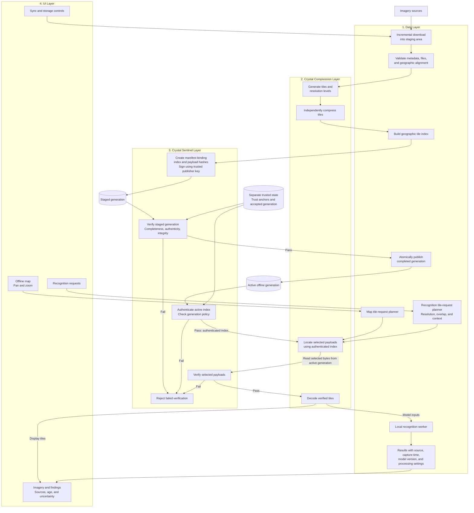

# Crystal Geo Architecture

Proposed architecture for secure offline imagery retrieval, map rendering,
and local recognition. Capabilities require implementation and validation.

The first Python development slice now builds and verifies the TX003 offline
before/after fixture. See [fixture usage and limitations](docs/fixture-usage.md).
It uses an **unsigned development manifest that must never be accepted in
production**, and is for development and noncommercial demonstration only.
The remaining architecture below is still proposed.

## Geographic tile index

Each tile entry records:

- Coordinate reference system, geographic bounds, and pixel-to-map transform.
- Tile coordinates, dimensions, resolution level, and boundary padding.
- Acquisition time and download time.
- Source, dataset version, and generation identifier.
- Container identifier, compressed payload offset, and length.
- Codec, decoding parameters, and expected payload hash.

The authenticated manifest binds the index and payload hashes to the
dataset generation.

## Offline update guarantees

1. Download into a separate staging area.
2. Validate source data and build the candidate generation.
3. Verify its authenticated manifest, index, and required payloads.
4. Publish the generation atomically.
5. Keep the previous generation available until publication succeeds.

Interrupted updates must not change the active dataset. Readers remain
pinned to one generation so they cannot mix old indexes with new payloads.

Signing authenticates the publisher; it does not prove the imagery is true
or current. Rollback protection requires separately protected freshness
state and a defined recovery policy.

## Independent workloads

Map rendering and recognition use separate request planners and work queues.
Recognition can request higher resolution and neighboring tiles without
blocking navigation. Both share the authenticated storage and retrieval path.

## Crystal Geo v0.1

First implement tiled storage, an authenticated geographic index, transactional
publication, and a minimal offline viewer.

Benchmark against an established tiled format using identical imagery:
storage size, bytes read, retrieval latency, peak memory, and verification
overhead.

Add local recognition after validating the storage and retrieval path.

## Implementation guide

See [Crystal Geo Mobile App: Detailed Build Instructions](BUILD_INSTRUCTIONS.md)
for the proposed mobile UI, data, compression, security, testing, and delivery
plan.
